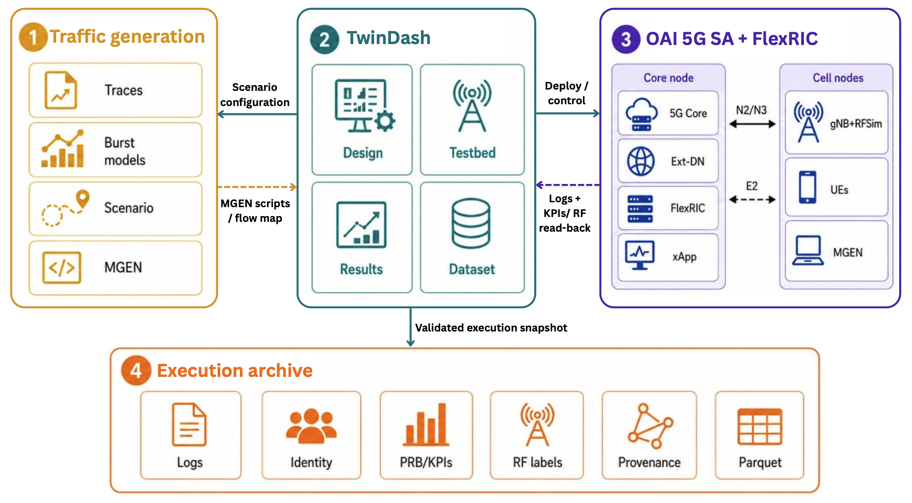

# TwinDash

[](https://github.com/GhinwaISMAIL/traffic-generation-dashboard/actions/workflows/quality.yml)
[](https://www.python.org/)
[](LICENSE)

TwinDash is a dashboard-based framework for designing, executing, validating,
and archiving reproducible 5G experiments. It connects trace-driven burst
traffic models and MGEN with OpenAirInterface (OAI) 5G Standalone, RFsim, and
FlexRIC on the POWDER testbed.

TwinDash is the software described in the accepted IEEE LCN 2026 demo paper
**“Demo: TwinDash – a Dashboard-Based Traffic Generator for Reproducible 5G
Experiments.”** If you use this code in academic work, please cite the demo as
described in [Citation](#citation).

## Main capabilities

- Multi-cell, multi-UE, and multi-application scenario design.
- Trace-driven burst schedules translated into MGEN workloads.
- OAI 5G SA experiment orchestration on reserved POWDER nodes.
- Scheduled RFsim changes whose applied state is read back and verified.
- Per-UE application, traffic, channel, and RAN KPI reconstruction.
- Provenance-aware immutable execution archives and Parquet dataset export.
- Execution-level train, validation, and test splits that avoid within-run
  leakage.


## Architecture



TwinDash connects the trace-driven traffic-generation pipeline with OAI 5G SA,
FlexRIC, RFsim, and MGEN on POWDER. Each execution is validated before its logs,
identity mappings, RAN KPIs, RF labels, provenance, and Parquet tables are
archived.

The dashboard exposes the lifecycle through four pages:

1. **Design** defines cells, UEs, applications, traffic classes, duration, and
   temporal parameters.
2. **Testbed** maps the scenario to POWDER nodes and defines optional verified
   RFsim transitions.
3. **Results** executes or inspects a workload, validates the collected
   evidence, and reconstructs cross-layer KPIs.
4. **Dataset** archives complete executions and exports selected runs as
   model-ready Parquet datasets.

## Companion traffic-generation repository

TwinDash consumes the `traffic_profiles/` output produced by
[multimodal-traffic-digital-twins](https://github.com/GhinwaISMAIL/multimodal-traffic-digital-twins).
The two repositories have separate responsibilities:

| Repository | Responsibility |
| --- | --- |
| `multimodal-traffic-digital-twins` | PCAP-derived flow and burst processing, clustering, Markov modeling, synthetic scenario generation, and MGEN export. |
| `traffic-generation-dashboard` (TwinDash) | Scenario/testbed configuration, deployment, evidence validation, KPI reconstruction, immutable archives, and dataset export. |

`dashboard_config.yaml` points TwinDash to the companion repository's
`traffic_profiles/` directory. For the `powder_ric5g_distributed` profile,
TwinDash also launches its tracked `deploy_ric5g.sh` runner.

## Quick start

```bash
git clone https://github.com/GhinwaISMAIL/traffic-generation-dashboard.git
cd traffic-generation-dashboard
python3 -m venv .venv
source .venv/bin/activate
python -m pip install -e '.[dev,export]'
cp dashboard_config.example.yaml dashboard_config.yaml
```

Set `profiles_dir` in `dashboard_config.yaml` to the companion repository's
`traffic_profiles/` directory, then start the dashboard:

```bash
streamlit run dashboard/app.py
```

For a live experiment, configure only nodes reserved for your current POWDER
experiment. Remote actions occur only after an explicit **Run** or **Fetch**
action. Stored mode is local: point `profiles_dir` at a directory containing a
previously completed run and inspect it from **Results** or **Dataset** without
starting a new reservation.

## Traffic backend compatibility

TwinDash currently uses MGEN as its implemented and validated packet-generation
backend. Application models are represented first as timed burst schedules and
then translated into MGEN events. This separation allows future exporters, but
the current release does not claim validated compatibility with iperf3, D-ITG,
or another traffic backend.

## Measurement-driven schedule input

On **Design**, select **Measurement-driven schedule** to upload a CSV or read a
local CSV file. Uploaded CSV files can be up to 1 GB (1024 MB) each. The local
file option is not subject to the upload limit; processing either input still
depends on available memory. Profile-based generation remains the default.
Schedule input does not use heavy/medium/light classes. Import freezes the input;
**Write measurement-driven scenario** also updates `scenario_config.yaml`.

The required columns are:

```text
session_id,experimental_ue,start_s,end_s,traffic_model,source_category,scenario_role
```

`session_id` must be nonempty and unique. Times are seconds from the logical
scenario start or `HH:MM:SS`. The dashboard uses a 24-hour logical day and
validates `0 <= start_s < end_s <= 86400`. Multiple sessions may overlap on one
UE. The canonical `scenario_role` column contains `baseline` or `augmented`.
The earlier `baseline_or_augmented` input name remains readable for
compatibility, but normalized output always uses `scenario_role`.

Paste the experimental UE identifiers from the frozen population, one per
line. The list determines the UE count, including 6, 7, or 12 UEs. Each scheduled
UE must belong to that independent list; identifiers are
not inferred from the sessions. Population members without sessions are allowed.
Application names must match discovered artifact folders or be mapped
explicitly. An explicit mapping preserves the original name in
`source_traffic_model`. Folder discovery does not validate model quality or the
contents of generated artifacts.

After all checks pass, **Schedule valid** appears with the logical duration,
population size, scheduled UE count, total/baseline/augmented session counts,
applications, earliest start, latest end, maximum concurrent UEs, and maximum
simultaneous sessions on one UE. Concurrent UEs are counted distinctly even
when one UE has several active sessions. Intervals use half-open boundaries:
a session ending exactly when another starts does not overlap it. The table
shows the first 20 normalized rows; the full schedule is retained for import.

**Import measurement-driven schedule** freezes the normalized input under:

```text
traffic_profiles/run_schedule_<id>/
    scenario_schedule.csv
    scenario_schedule.json
    scenario_schedule.sha256.json
    config.json
```

The metadata records the original CSV checksum, normalized CSV checksum,
independent UE population, recognized models, logical duration, and validation
summary. Optional fields, including `source_session_id`, `parent_interval`, and
`augmentation_iteration`, remain in the CSV. `source_session_id` may refer to
upstream measured data and is not required to name another row in this import.

Publication is atomic. Identical imports reuse the same run; changed inputs
produce another run. Existing frozen files are verified and never overwritten.
Use `schedule.load_frozen(run_dir)` downstream to verify the input checksums
before reading the normalized sessions. The normalized CSV can also be
downloaded directly.

Imported runs have `generation_status: pending` and stay out of the Results,
Dataset, and Testbed run selectors. Deployment and fetch actions reject them.

To generate traffic, choose a seed and press **Write measurement-driven
scenario**. The configuration points to the frozen CSV, records an explicit
experimental-UE-to-`ue1`…`ueN` mapping, and pins the selected DL and UL burst
artifacts by path and checksum. Both directional artifacts must exist and
contain valid burst data. Network and temporal-correlation settings come from
the saved configuration. The previous profile configuration is retained so
returning to profile-based generation restores its settings.

In the companion traffic-generator repository, run `build_scenario_1.ipynb`,
then `mgen_script_2.ipynb`. The scenario builder samples one learned flow per
session and direction, applies the existing application timing model within
that session, and shifts its timestamps by `start_s`. It retains overlapping
sessions and recomputes packet rates after fitting bursts to the session window.
This policy does not fill the entire session continuously or force the generated
byte count to match `source_traffic_bytes`; source demand remains a reference.

Outputs go to `traffic_profiles/run_measurement_<id>/`, including the frozen
schedule, `generation_config.json`, `ue_mapping.csv`, `ue_flow_assignments.csv`,
burst tables, and the existing MGEN script/manifest layout. Session identifiers,
roles, source-session references, and provenance are retained in the burst and
flow maps. `session_generation.csv` compares source fields with generated DL/UL
offered bytes. `designed_kpis.parquet` records offered load derived from the
exported sender events. Actual sent/received traffic still requires a testbed run.

The run stays `bursts_ready` until MGEN export succeeds, then becomes `complete`
and appears in TwinDash. Identical requests reuse verified outputs; changes to
the seed, configuration, or selected artifacts produce another run. The profile
notebook path remains available and excludes schedule imports from automatic
run selection. This bridge does not implement augmentation or radio replay.

The integration test uses `TWINDASH_GENERATOR_REPO` when set, otherwise the
configured generator repository. Run its standalone tests with the dashboard's
Python environment, which provides pandas, NumPy, PyArrow, PyYAML, and pytest.

The Python interface is available to analysis notebooks:

```python
from twindash import schedule

plan = schedule.load("baseline12_augmented_schedule.csv", logical_duration_s=86400)
plan = schedule.validate(plan, expected_ues=ue_population, available_models=application_models)
summary = schedule.summary(plan)
selected = schedule.execution_window(plan, 64800, 66600)
run_dir = schedule.import_run(plan, profiles_dir, available_models=application_models)
frozen_plan = schedule.load_frozen(run_dir)
```

Execution-window previews keep the original `start_s` and `end_s` and add
`execution_start_s`, `execution_end_s`, and `session_offset_s`. A session already
active at the window start retains its elapsed offset. Previewing a window does
not compress time or regenerate a session from its beginning.

## Channel schedules from calibrated CSV files

On **Testbed → Channel schedule**, choose **Upload CSV** or **Local CSV file**
to import a calibrated noise/path-loss timeline. The required columns are:

```csv
at_s,target,direction,parameter,value
```

Use `noise_power_dB` or `ploss` for the parameter. Downlink targets individual
UEs; uplink targets cells. Experimental UE names are mapped using the selected
run's `ue_mapping.csv`. The importer checks every row, rejects unknown targets
and conflicting changes, and previews the first 20 rows without truncating the
saved schedule. Uploading alone does not alter a run: enable the schedule and
press **Save channel schedule** to write `channel_schedule.json`. Saving is
blocked while a TwinDash deployment holds that run's lock.

The manual table remains available. The panel includes a downloadable CSV
header, the run's UE mapping and normalized CSV export. See the
[channel CSV schema](docs/channel_schedule_csv.md) for field types, target groups,
examples and timing rules. Bulk import does not change the current runner's
sequential SSH replay behavior or provide high-frequency timing guarantees.

## Offered load over time

For a run with existing MGEN sender scripts, analysis notebooks can calculate
projected UL/DL load in intervals:

```python
from twindash.mgen_script import projected_load_timeseries

load = projected_load_timeseries(run_dir, interval_s=900)
```

The result contains `interval_start_s`, `interval_end_s`, `direction`,
`offered_packets`, `offered_bytes`, and `offered_mbps`. The calculation integrates
each PERIODIC UDP ON/OFF window over its overlap with each interval. It includes
idle intervals and uses the actual length of a shorter final interval. The
default endpoint is `config.json`'s `simulation_duration`; `start_s` and `end_s`
can select a smaller window. Times here are relative to the MGEN run start.

When `flow_batch_map.csv` carries session provenance, pass
`group_by=("scenario_role", "session_id")` to retain it in the output. Missing or
ambiguous grouping metadata is rejected. Unsupported sender events and
unmatched ON/OFF events are rejected rather than silently omitted.

Packet and byte values are rate-integrated projections and may be fractional.
They are not observed packet counts or measured network capacity; SEND/RECV logs
remain the source of actual transmission and delivery evidence. The existing
whole-flow projection and Results/Dataset pages continue to use their current
interfaces.

## Run-folder contract

```text
traffic_profiles/run_<id>/
  config.json
  run_profile.json
  designed_kpis.parquet
  observed_kpis.parquet
  channel_schedule.json       # optional, authored before deployment
  mgen_scripts/
    manifest.csv
    flow_batch_map.csv
    dn_dl_tx.mgn
    dn_ul_rx.mgn
    ue*_ul_tx.mgn
    ue*_dl_rx.mgn
  logs/
    deployment.log
    run_timing.json
    rnti_map.csv
    prb_by_second.csv
    xapp.log
    dn_*_*.log
    ue*_*_*.log
  executions/
    mgen-<timestamp>/          # immutable snapshot of one deployment
      metadata.json
      ue_second_features.parquet
      observed_kpis.parquet
      packet_outcomes.parquet
      ue_app_second_observed.parquet
      channel_segments.parquet
      segment_training_table.parquet
      logs/                    # timing, mapping, xApp, PRB, channel evidence
```

`flow_batch_map.csv` is the authoritative packet-attribution key after UPF NAT.
Ports remain shared by direction (UL 5000 and DL 5001); flow IDs distinguish
UE, application, direction, and request batch.

`run_profile.json` snapshots the deployment type and measurement capabilities
used for that execution. Changing the active testbed configuration later
therefore cannot reinterpret an archived run.

## Measurement and provenance safeguards

- MGEN wall clocks are anchored to epoch time in `run_timing.json`.
- FlexRIC rows retain both RFsim/service-model source time and core receipt
  time; the explicit receipt clock is used for per-second traffic/RAN joins.
- Legacy single-clock radio captures remain visible but cannot be archived as
  valid cross-layer training data.
- Runtime RFsim values are read back. Missing verification or disagreement
  between requested and applied values prevents the channel segment from being
  labeled as training-eligible.
- `rnti_map.csv` belongs to one run and must not be reused after UE
  reattachment.
- Throughput is UDP payload goodput over the configured run duration.

Receipt-aligned MCS, PRB, BLER, and SNR are post-run diagnostics. When a
source/receipt-clock divergence warning is present, these values must not be
interpreted as instantaneous channel responses or used as pre-run model
inputs.

## Command-line interface

The CLI and Streamlit dashboard use the same Python modules and configuration:

```bash
python -m twindash.cli list
python -m twindash.cli preflight <run_name>
python -m twindash.cli deploy <run_name>
python -m twindash.cli deploy <run_name> --include-raw
python -m twindash.cli archive <run_name>
python -m twindash.cli dataset <dataset_name> \
  --execution mgen-<timestamp> [--execution mgen-<timestamp> ...]
python -m twindash.cli fetch <run_name>
python -m twindash.cli kpis <run_name>
```

`preflight` is local and side-effect free. `deploy` runs the remote experiment,
rebuilds flow KPIs, and creates an immutable execution archive. For a
distributed RIC5G run, `fetch` verifies artifacts already collected by the
runner and rebuilds `observed_kpis.parquet`.

## Validation and security

Run the release-validation gate before a merge or tagged research release:

```bash
bash bin/release-validation.sh
```

The gate compiles the Python code, runs the automated tests, smoke-tests all
four Streamlit pages, and checks the CLI. See
[RELEASE_VALIDATION.md](RELEASE_VALIDATION.md) for the live POWDER
acceptance procedure and [SECURITY.md](SECURITY.md) for the supported deployment
model.

## Citation

If you use TwinDash or any part of this repository in a publication, please
cite the accepted demo paper. The DOI and final proceedings metadata are not
available yet and should be added here when assigned.

```bibtex
@inproceedings{ismail2026twindash,
  author    = {Ghinwa Ismail and Samir Si-Mohammed and Fabrice Theoleyre},
  title     = {{Demo: TwinDash -- a Dashboard-Based Traffic Generator for Reproducible 5G Experiments}},
  booktitle = {Proceedings of the IEEE Conference on Local Computer Networks (LCN)},
  year      = {2026},
  note      = {Accepted demo paper; DOI and final bibliographic details forthcoming}
}
```


## License

TwinDash is licensed under the [Apache License 2.0](LICENSE). The citation
request above is scholarly attribution guidance; it does not add a condition
to the Apache-2.0 license.
